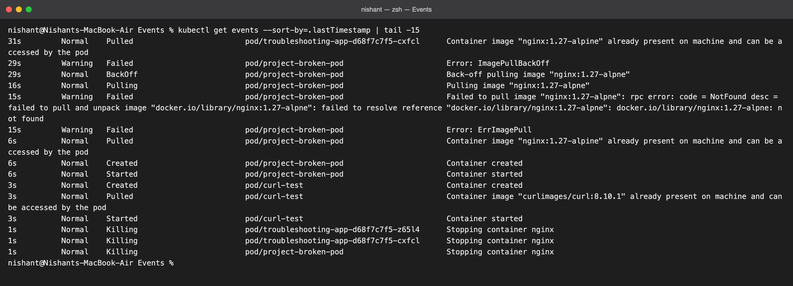
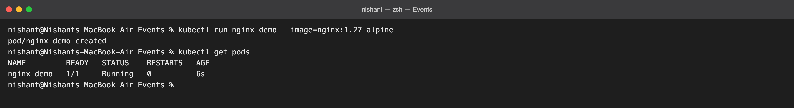
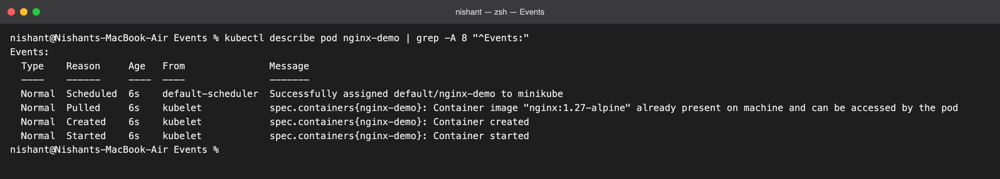
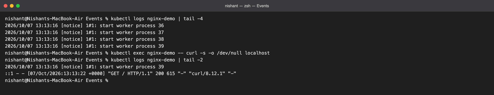
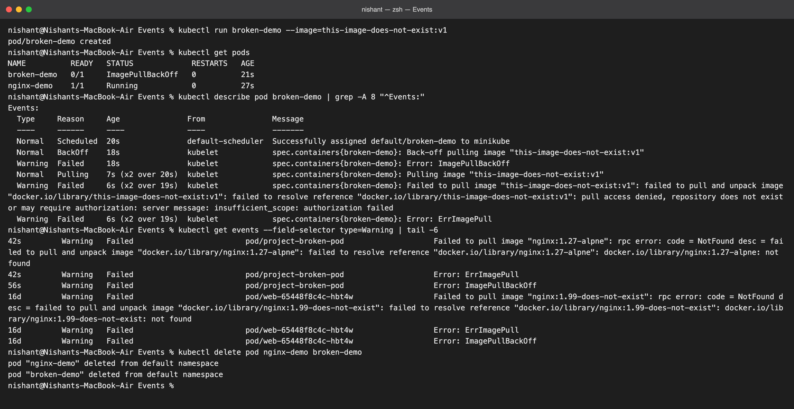

# Kubernetes Events versus Logs

**Name:** Nishant
**Course:** SST DevOps & Cloud [SWE]

Run on my minikube cluster; every screenshot is from that run.

## What an Event is

An **Event** is a short, timestamped note that a Kubernetes component writes about an object: the scheduler placed a Pod, the kubelet pulled an image, a container started, a pull failed. Events are:

- produced by Kubernetes itself (scheduler, kubelet, controllers), never by my application;
- attached to one object in one namespace;
- short-lived, kept for about an hour and then dropped.

Events answer *"what did Kubernetes do with my object, and when?"*

## What Logs are

**Logs** are whatever the process inside the container writes to stdout and stderr: nginx access lines, a Python traceback, "server started on port 8000". They are:

- produced by the application, not by Kubernetes;
- kept as long as the container exists (and `--previous` reaches the last crashed instance), or shipped to a log system to keep longer.

Logs answer *"what is my application doing or saying?"*

## Side by side

| | Events | Logs |
| --- | --- | --- |
| Written by | Kubernetes components | The container's process |
| About | Lifecycle and state changes of an object | Application behaviour |
| Where to read | `kubectl get events`, `kubectl describe <object>` | `kubectl logs <pod>` |
| Lifetime | About one hour | While the container exists, unless shipped elsewhere |
| Use it for | Scheduling, image pulls, restarts, probe failures | Errors, requests, business logic |

A Pod stuck in `ImagePullBackOff` has no logs at all, because the container never started; only events explain it. A Pod that is Running but returning 500s has perfectly normal events; only the logs explain it.

## Commands I ran

```bash
# 1. everything the cluster recorded recently, oldest first
kubectl get events --sort-by=.lastTimestamp

# 2. a healthy Pod
kubectl run nginx-demo --image=nginx:1.27-alpine
kubectl get pods

# 3. the events for that one Pod: Scheduled, Pulled, Created, Started
kubectl describe pod nginx-demo

# 4. the application's own output, then make it log one more line
kubectl logs nginx-demo
kubectl exec nginx-demo -- curl -s -o /dev/null localhost
kubectl logs nginx-demo

# 5. a broken Pod: Warning events, no logs
kubectl run broken-demo --image=this-image-does-not-exist:v1
kubectl describe pod broken-demo
kubectl get events --field-selector type=Warning

kubectl delete pod nginx-demo broken-demo
```

## Screenshots

### 1. Cluster-wide events

`kubectl get events --sort-by=.lastTimestamp`. On my cluster this listing still carried the tail of the Session 14 troubleshooting run: the `ImagePullBackOff` warnings for `project-broken-pod`, the successful pull once the tag was fixed, and the `Killing` events from the cleanup.



### 2. A healthy Pod



### 3. Events for one Pod

Four Normal events in order: `Scheduled` (scheduler), then `Pulled`, `Created`, `Started` (kubelet). That is the whole life story of a healthy start.



### 4. Logs from the container

The first `kubectl logs` shows nginx starting its worker processes. After one `curl` from inside the Pod, a new access-log line appears: `"GET / HTTP/1.1" 200`. Kubernetes recorded no event for that request, because serving a request is the application's business, not the cluster's.



### 5. A broken Pod

`broken-demo` sits in `ImagePullBackOff`. Its events alternate `Pulling`, `Failed ... repository does not exist`, `ErrImagePull`, `BackOff`, and `kubectl get events --field-selector type=Warning` lists only the failures. There are no logs to read, which is itself the clue.



## In one sentence

Events tell me what Kubernetes did to my Pod; logs tell me what my Pod did. When something is wrong, read the events first to learn whether the container even started, then the logs to learn what it did once it had.
