# Session 21: DevOps Final Capstone, TaskBoard (Python)

**Name:** Nishant
**Course:** SST DevOps & Cloud [SWE]
**Session:** 21
**Repository:** https://github.com/Nishant-art27/Devops-Ass1

Session 21 has two halves. This folder is the first half: the classroom lab, where the reference application TaskBoard (React + Vite, FastAPI, PostgreSQL) travels from a laptop to a monitored Kubernetes cluster, Part A to Part O of the session notes. The second half, the student project in my own domain, is TicketHub in [final-devops-project](../final-devops-project/README.md); its DevOps layer follows the same architecture as this lab.

```
laptop                                      kind cluster "taskboard" (local Kubernetes)
  pytest (13 tests, SQLite)                   ingress-nginx  http://taskboard.local
  vite build                                     ├── /            -> taskboard-frontend  (2 replicas, nginx, non-root)
  docker compose up --build                      ├── /api /docs   -> taskboard-backend   (2..5 replicas via HPA, FastAPI, non-root)
  trivy image (both images clean)                │                        └── taskboard-postgres (PVC)
  GitHub Actions: test -> build+scan+push -> deploy      ServiceMonitor -> Prometheus -> Grafana "TaskBoard API (Session 21)"
  terraform init / validate (AWS VPC + EKS)       troubleshooting: broken image, broken service
```

| Part of the session | Where | Evidence |
| --- | --- | --- |
| A. Understand the application | [taskboard/backend](taskboard/backend), [taskboard/frontend](taskboard/frontend) | [API docs](screenshots/02-api-docs.png) |
| B. Run it locally (Compose) | [taskboard/docker-compose.yml](taskboard/docker-compose.yml) | [compose up](screenshots/t-03-compose-up.png), [dashboard](screenshots/01-app-dashboard.png) |
| C. Testing | [taskboard/backend/tests](taskboard/backend/tests) | [pytest -v, 13 passed](screenshots/t-01-pytest.png) |
| D. Git and GitHub | this repository | commit history on GitHub |
| E. Docker | the two Dockerfiles | [images, non-root users](screenshots/t-07-docker-images.png) |
| F. CI/CD | [.github/workflows/session21-taskboard-ci-cd.yml](../.github/workflows/session21-taskboard-ci-cd.yml) | [green run on `main`](screenshots/04-ci-pipeline-run.png), [GHCR packages](https://github.com/Nishant-art27/Devops-Ass1/pkgs/container/taskboard-backend) |
| G. Security scanning | Trivy step in the workflow, run locally too | [before](screenshots/t-09-trivy-before.png), [after](screenshots/t-08-trivy-after.png) |
| H. Terraform | [taskboard/terraform](taskboard/terraform) | [init, validate, plan](screenshots/t-21-terraform.png) |
| I, J. Kubernetes + Helm | [taskboard/k8s](taskboard/k8s), [taskboard/helm/taskboard](taskboard/helm/taskboard) | [helm install](screenshots/t-12-helm-install.png), [objects](screenshots/t-13-k8s-objects.png) |
| K. Ingress | `helm/taskboard/templates/ingress.yaml` | [curl through the host](screenshots/t-14-ingress-access.png), [browser](screenshots/03-ingress-browser.png) |
| L. HPA | `helm/taskboard/templates/hpa.yaml`, [scripts/load-test.sh](taskboard/scripts/load-test.sh) | [scaling under load](screenshots/t-15-hpa.png) |
| M. Monitoring | [taskboard/monitoring](taskboard/monitoring) | [Prometheus targets](screenshots/05-prometheus-targets.png), [Grafana](screenshots/06-grafana-dashboard.png) |
| N. Troubleshooting lab | [taskboard/troubleshooting](taskboard/troubleshooting) | [broken image](screenshots/t-19-lab-broken-image.png), [broken service](screenshots/t-20-lab-broken-service.png) |
| O. Final demo | this README, section "Demo script" | |

The upstream session notes and rubric are kept next to this file as [SESSION-NOTES-upstream.md](SESSION-NOTES-upstream.md) and [GRADING-upstream.md](GRADING-upstream.md).

## Quick start

```bash
cd session-21-python-capstone/taskboard

# tests
cd backend && python3.11 -m venv .venv && source .venv/bin/activate && pip install -r requirements.txt && pytest -v && cd ..

# whole stack on the laptop: UI on :3000, API and Swagger on :8000
docker compose up --build -d
BASE_URL=http://localhost:8000 ./scripts/seed.sh
docker compose down -v

# local Kubernetes (ports 80/443 mapped into the kind node, ingress-nginx, metrics-server)
kind create cluster --config k8s/kind-config.yaml
kubectl apply -f https://raw.githubusercontent.com/kubernetes/ingress-nginx/main/deploy/static/provider/kind/deploy.yaml
kubectl apply -f https://github.com/kubernetes-sigs/metrics-server/releases/latest/download/components.yaml
kubectl patch deployment metrics-server -n kube-system --type=json -p='[{"op":"add","path":"/spec/template/spec/containers/0/args/-","value":"--kubelet-insecure-tls"}]'
kind load docker-image taskboard-backend:local taskboard-frontend:local --name taskboard
kubectl apply -f k8s/namespace.yaml
helm upgrade --install taskboard helm/taskboard -n taskboard -f helm/taskboard/values-local.yaml --wait
curl --resolve taskboard.local:80:127.0.0.1 http://taskboard.local/api/tasks/stats

# monitoring
helm repo add prometheus-community https://prometheus-community.github.io/helm-charts
helm upgrade --install monitoring prometheus-community/kube-prometheus-stack -n monitoring --create-namespace -f monitoring/prometheus-values.yaml --wait
helm upgrade taskboard helm/taskboard -n taskboard -f helm/taskboard/values-local.yaml --set monitoring.serviceMonitor.enabled=true
kubectl apply -f monitoring/grafana-dashboard.yaml
kubectl port-forward -n monitoring svc/monitoring-kube-prometheus-prometheus 9091:9090   # http://localhost:9091/targets
kubectl port-forward -n monitoring svc/monitoring-grafana 3001:80                        # admin / admin
```

`taskboard.local` is not in `/etc/hosts` on this Mac (no sudo), so every command resolves it explicitly with `curl --resolve`, and the browser screenshots use Chromium's host-resolver rules. With an `/etc/hosts` entry `127.0.0.1 taskboard.local` the plain URL works.

---

## Part A. The application

**Backend** (`backend/app`): FastAPI, SQLAlchemy 2 models, Pydantic schemas, Alembic migration `0001_create_tasks.py`, Prometheus instrumentation.

| Method | Path | Does |
| --- | --- | --- |
| GET | `/health` | Liveness: the process answers, never touches the database |
| GET | `/ready` | Readiness: `SELECT 1` against PostgreSQL, 503 when it fails |
| GET | `/metrics` | Prometheus exposition format |
| GET | `/api/tasks` | List, newest first, optional `?status=` filter |
| GET | `/api/tasks/stats` | Counts per status for the KPI cards |
| GET | `/api/tasks/{id}` | One task, 404 if missing |
| POST | `/api/tasks` | Create (201), priority and status are validated enums |
| PUT | `/api/tasks/{id}` | Partial update |
| DELETE | `/api/tasks/{id}` | Delete (204) |

**Frontend** (`frontend/src`): a React dashboard with a dark sidebar, KPI cards, a filterable task table, priority and status badges, an activity feed, a pipeline indicator, a create-task modal and loading/error states. The browser only ever calls `/api/...` on its own origin; nginx (Compose) or the Ingress (Kubernetes) routes that to the backend, so the UI never knows the backend hostname.

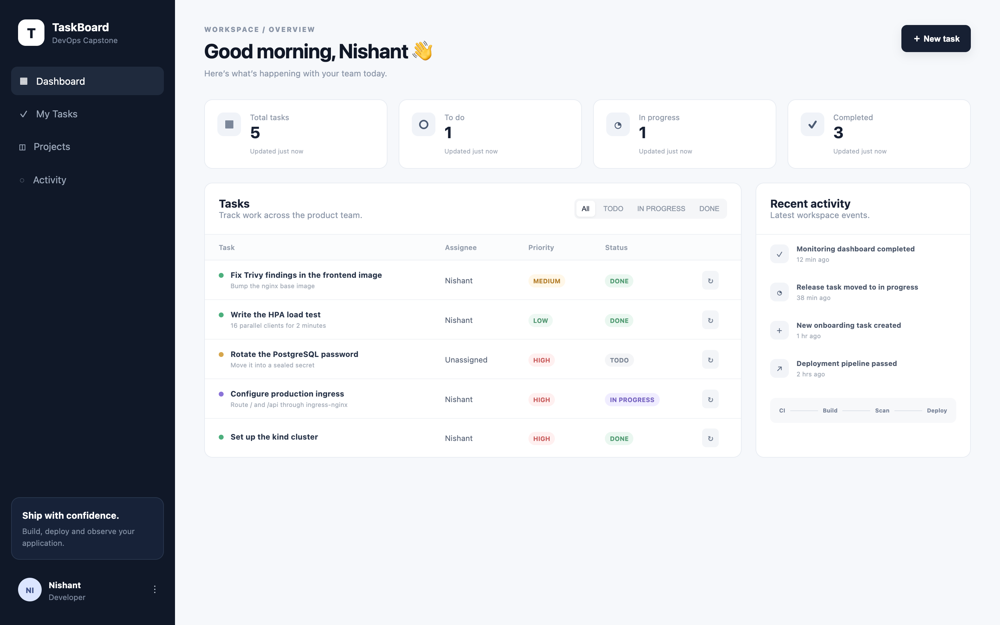

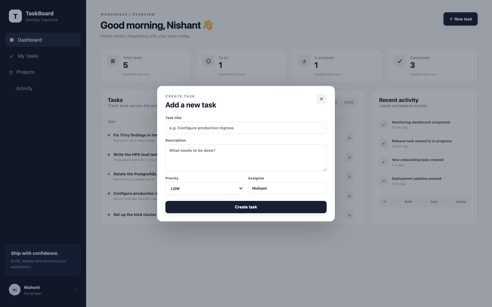

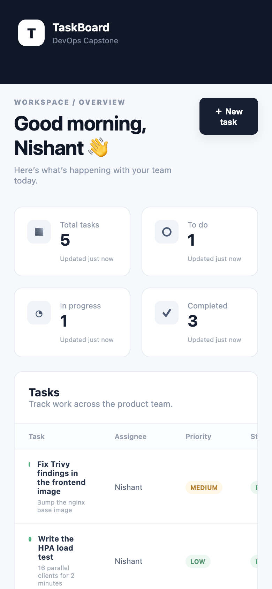

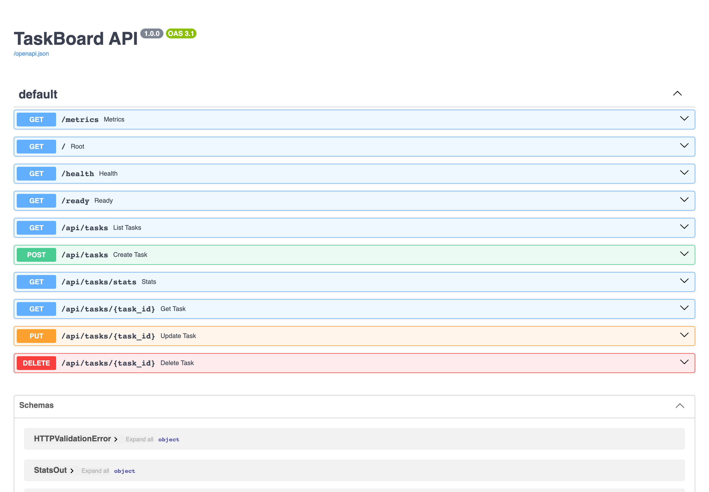

### What I fixed in the reference code before it would run end to end

The upstream TaskBoard is a teaching skeleton; several things stop it from working as the session describes. Each fix is small and in the folder:

| Problem in the reference | Fix |
| --- | --- |
| Ingress sent `/api` to service `taskboard-backend:8080`; the Service is on 8000 and, with the `fullname` helper, is named `taskboard-taskboard-backend` | `_helpers.tpl` now derives names from the release (`taskboard-backend`, `taskboard-frontend`, `taskboard-postgres`) and every template uses them; Ingress targets port 8000 and also routes `/docs` and `/openapi.json` |
| Frontend nginx had `proxy_pass http://backend:8000` hard-coded; nginx resolves that name once at start-up and refuses to start when it does not resolve, which is the case in Kubernetes until the backend Service exists | `nginx.conf.template` rendered by the image entrypoint from `BACKEND_HOST`/`BACKEND_PORT`, with the upstream in a variable and a `resolver` taken from the container's DNS, so the name is resolved per request; Compose passes `backend`, the chart passes the Service's cluster FQDN |
| Frontend image ran nginx as root; `package.json` pinned every dependency to `latest` with no lockfile; Vite proxy pointed at port 8080 | `nginxinc/nginx-unprivileged` on port 8080 (uid 101), pinned React/Vite versions with `package-lock.json` and `npm ci`, proxy to 8000 |
| Backend started `alembic upgrade head` from every replica at once (race on first install) and before PostgreSQL was ready; on a fresh kind node the postgres image pull alone takes over a minute, so the liveness probe killed the container while it waited | `app/migrate.py`: waits up to three minutes for the database, takes a PostgreSQL advisory lock, then runs Alembic; the Deployment has a `startupProbe` so liveness only begins once the app answers |
| `ServiceMonitor` enabled by default, so `helm install` failed on any cluster without the Prometheus Operator CRDs | Off by default, enabled with `--set monitoring.serviceMonitor.enabled=true` after kube-prometheus-stack is in |
| Compose had no health checks, so the backend could start before PostgreSQL accepted connections | `pg_isready` check on postgres, `/ready` check on the backend, `depends_on: condition: service_healthy` |
| Three tests, one of which wrote `test.db` into the project; `@app.on_event("startup")` is deprecated | `conftest.py` with a throw-away SQLite file per test, 13 tests, FastAPI lifespan |
| `load-test.sh` hit `/api/health`, which does not exist | Hits `/api/tasks` with N parallel clients for M seconds |
| Trivy would fail the pipeline: `starlette 0.41.3` has three fixable HIGH CVEs, `nginx:1.27-alpine` carries 41 HIGH and 2 CRITICAL fixable OS CVEs | FastAPI 0.143 / Starlette 1.8, `nginx-unprivileged:1.31-alpine` (Alpine 3.24); both images scan clean |
| Terraform in one-line HCL, no `terraform.tfvars.example` | Formatted, variables for every tunable, example tfvars, subnet tags for EKS load balancers |
| CI workflow lived inside the project folder (GitHub ignores it there) and used the mixed-case repository owner in the GHCR image name (GHCR requires lower case) | Workflow at the repository root with path filters, image names lower-cased |
| The workflow pinned `aquasecurity/trivy-action@0.30.0`: that tag does not exist (releases are `v`-prefixed), and `v0.30.0` itself depends on a `setup-trivy@v0.2.2` tag that has since been deleted, so the build job died at "Set up job" before any step ran | `aquasecurity/trivy-action@v0.36.0`, which pins its `setup-trivy` dependency by commit |

The name in the UI was changed from the template's to mine; everything else in the UI is the reference design.

---

## Part B. Run it locally

`docker compose up --build -d` builds both images and starts PostgreSQL, the backend (after PostgreSQL is healthy) and the frontend (after the backend's `/ready` is healthy).

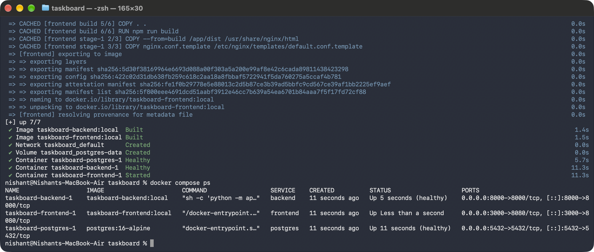

Smoke test straight against the API and through the nginx proxy on port 3000: health, readiness, create, seed five tasks, update, delete, 404 after delete, filter by status, stats.

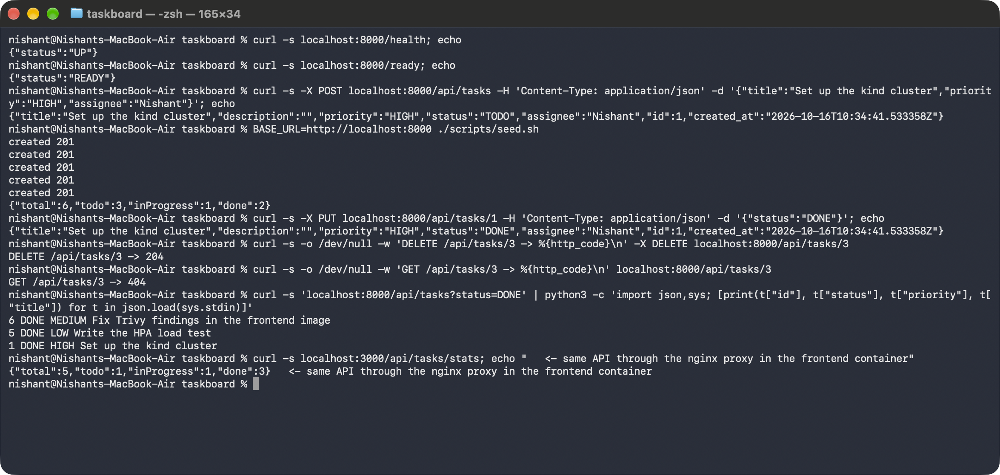

The `tasks` table and the Alembic version row in PostgreSQL:

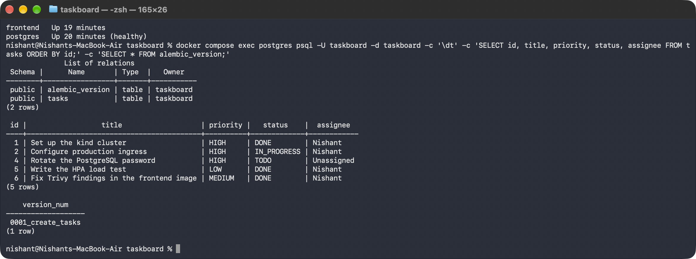

---

## Part C. Testing

```bash
cd backend && source .venv/bin/activate && pytest -v
```

Thirteen tests across eight endpoints. `tests/conftest.py` points `DATABASE_URL` at a SQLite file next to the tests, drops and recreates the schema for every test and deletes the file at the end; the PostgreSQL the app uses in Docker is never touched. `pytest.ini` sets `pythonpath = .` and `testpaths = tests`.

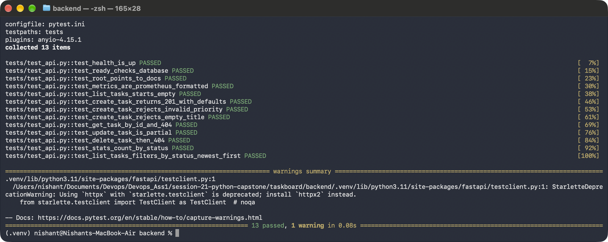

This is the first quality gate: the pipeline's `test` job runs exactly this, and the image build job needs it to pass.

---

## Part D. Git and GitHub

One folder per session in a public repository, `.gitignore` files at the folder, backend, frontend and terraform levels (`.venv/`, `__pycache__/`, `node_modules/`, `dist/`, `.env`, `.terraform/`, `*.tfstate*`, `*.tfvars` except the example). The suggested commit sequence for this folder, one commit per concern:

```
session21: add TaskBoard reference application
session21: fix Helm names, ingress port and nginx backend host
session21: non-root frontend image, pinned dependencies and lockfile
session21: migration runner with advisory lock and compose health checks
session21: pytest suite with SQLite conftest (13 tests)
session21: upgrade FastAPI/Starlette and nginx base to clear Trivy findings
session21: GitHub Actions pipeline at the repository root
session21: Terraform VPC + EKS variables and tfvars example
session21: kind config, Grafana dashboard ConfigMap, load and seed scripts
session21: README and screenshots
```

---

## Part E. Docker

- `backend/Dockerfile`: `python:3.12-slim`, dependencies installed before the code is copied (layer caching), Alembic and the app, user `appuser` (uid 10001), port 8000, `python -m app.migrate && uvicorn ...`.
- `frontend/Dockerfile`: stage one builds the bundle with Node 22 and `npm ci`; stage two is `nginxinc/nginx-unprivileged:1.31-alpine` with only `dist/` and the nginx template, user `nginx` (uid 101), port 8080.

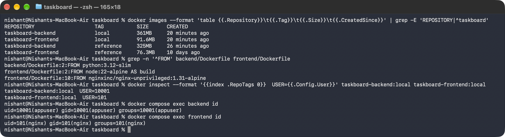

The frontend build on its own:

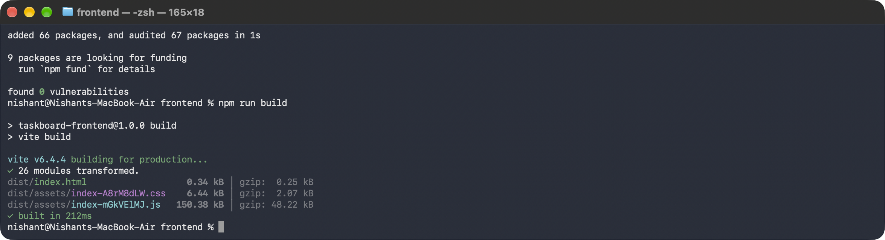

---

## Part F. CI/CD

[`.github/workflows/session21-taskboard-ci-cd.yml`](../.github/workflows/session21-taskboard-ci-cd.yml) runs on every push or pull request to `main` that touches this folder, and on demand.

```
test ──────────────► build-scan-push ─────────────► deploy
pytest -v            docker build x2                helm upgrade --install
npm ci, npm build    trivy (HIGH,CRITICAL, exit 1)  tag = commit SHA
                     push to GHCR (main only)       (skips itself when no KUBE_CONFIG_DATA secret)
```

- Tags are the commit SHA, never `latest`: `ghcr.io/nishant-art27/taskboard-backend:<sha>` and `.../taskboard-frontend:<sha>`.
- A failing test stops the build; a HIGH or CRITICAL finding stops the push; a pull request builds and scans but never pushes.
- The deploy job decodes a kubeconfig from the `KUBE_CONFIG_DATA` secret and runs `helm upgrade --install` with `--set backend.tag=<sha> --set frontend.tag=<sha>`. Without that secret it prints why it is skipping and ends green, so the pipeline is usable before a cluster is reachable from GitHub.

The pipeline on `main` ([all runs](https://github.com/Nishant-art27/Devops-Ass1/actions/workflows/session21-taskboard-ci-cd.yml)) is green end to end: the test job, the build job with both Trivy scans clean and both images pushed, and the deploy job (which skipped itself, since no cluster secret is set). The two packages, [taskboard-backend](https://github.com/Nishant-art27/Devops-Ass1/pkgs/container/taskboard-backend) and [taskboard-frontend](https://github.com/Nishant-art27/Devops-Ass1/pkgs/container/taskboard-frontend), are public on GHCR and tagged with the commit SHA. The first runs failed at "Set up job" because of the Trivy action tag described in Part A.

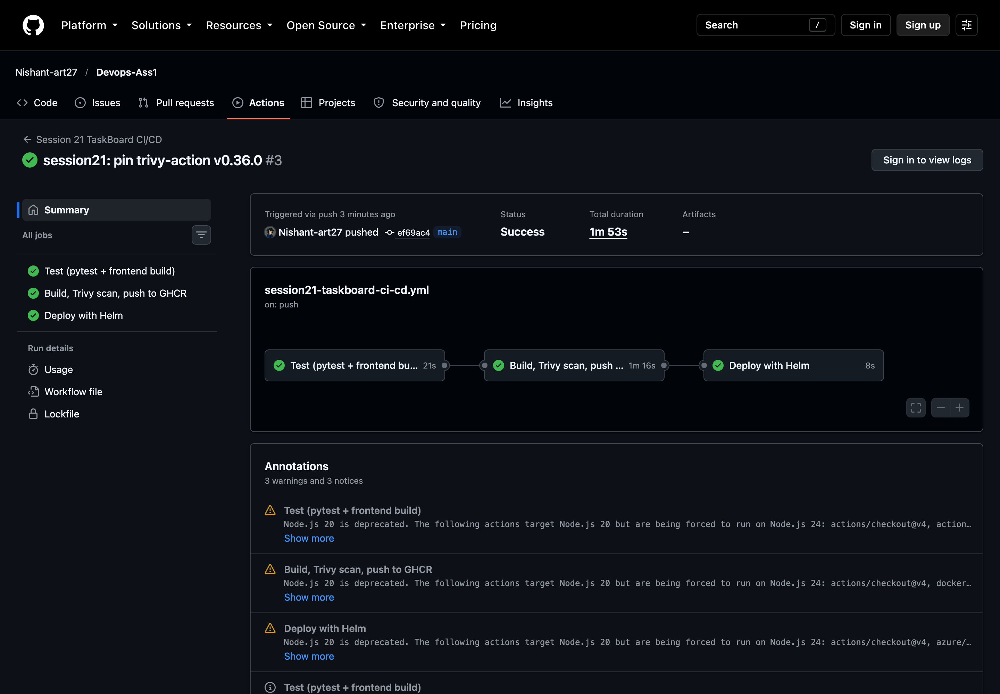

---

## Part G. Security scanning

Trivy scans the finished image filesystem: the OS packages of the base image and the language packages installed on top. `--ignore-unfixed` keeps only findings that have a patched version, so the gate is about things we can actually act on.

The reference images, scanned before any change:

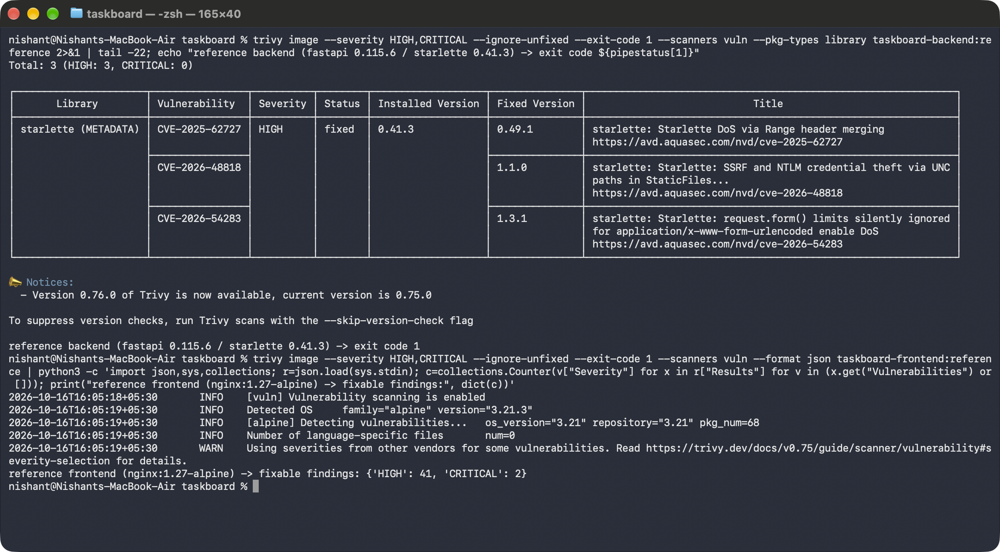

**One CVE explained.** CVE-2025-62727 in Starlette 0.41.3 (HIGH, fixed in 0.49.1): a request with many overlapping `Range` header values made Starlette's static-file handler merge ranges in quadratic time, so a single client could pin a worker's CPU, a denial of service. FastAPI 0.115.6 pinned Starlette below 0.42, so the fix was to move to FastAPI 0.143 and Starlette 1.8; the two newer Starlette CVEs in the same table went away with the same upgrade. On the frontend the 43 findings were all in Alpine 3.21 packages under nginx 1.27 (openssl, libxml2, musl, nghttp2, tiff); the fix was the current `nginx-unprivileged:1.31-alpine` on Alpine 3.24.

After the upgrades both images pass the same gate the pipeline uses:

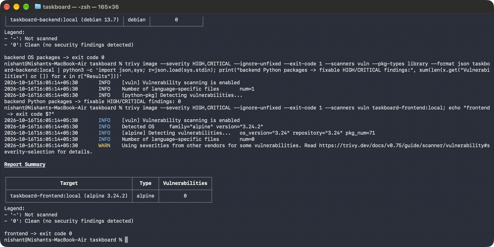

---

## Part H. Terraform

`taskboard/terraform` describes the production home of the application on AWS with the community modules: `terraform-aws-modules/vpc` 5.8 (VPC `10.20.0.0/16`, two public and two private subnets across `ap-south-1a/b`, one NAT gateway, subnet tags for EKS load balancers) and `terraform-aws-modules/eks` 20.37 (EKS 1.31, public endpoint, CoreDNS/kube-proxy/VPC CNI add-ons, one managed node group of `t3.medium`, 2 to 4 nodes). Every tunable is a variable; `terraform.tfvars.example` shows them; credentials come from the environment, never from the files.

`terraform init` downloaded the modules and providers, `terraform fmt -check` and `terraform validate` pass. `terraform plan` stops at the AWS credential lookup because this laptop has no AWS profile configured, which is exactly what should happen: nothing in this folder can reach an account by accident. `plan`, `apply`, the console screenshot and `destroy` are the only steps of this session that need the account owner.

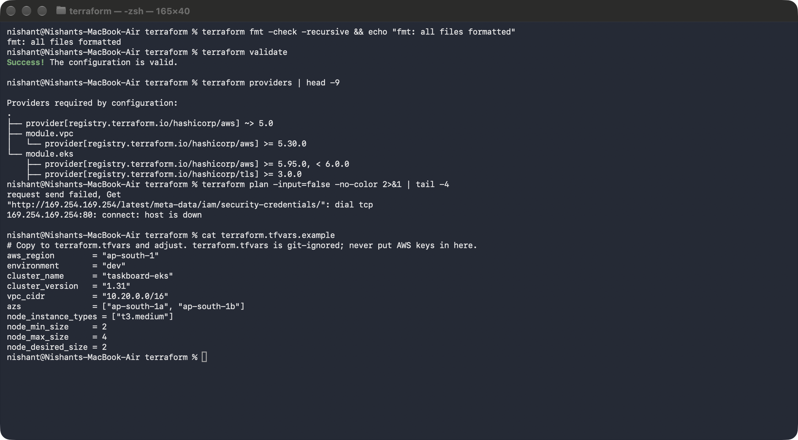

---

## Parts I and J. Kubernetes and Helm

The cluster is kind, created from `k8s/kind-config.yaml` (ports 80 and 443 of the laptop mapped into the node, `ingress-ready` label), with ingress-nginx and Metrics Server installed on top.

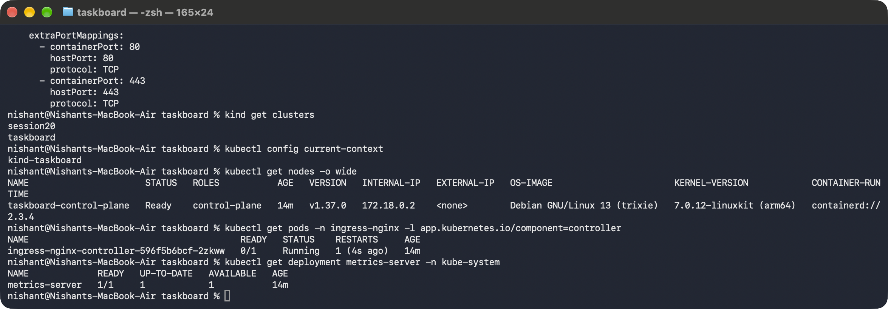

The images are loaded into the node instead of pulled from a registry (`kind load docker-image`), so `values-local.yaml` points at `taskboard-backend:local` and `taskboard-frontend:local`.

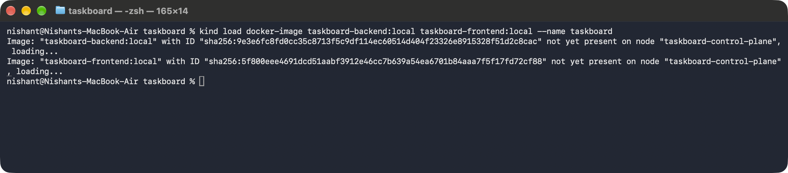

The chart (`helm/taskboard`) creates: a Secret with the database credentials and the ready-made `DATABASE_URL`, a PVC-backed PostgreSQL Deployment and Service, the backend Deployment (2 replicas, readiness on `/ready`, liveness on `/health`, CPU/memory requests and limits, non-root) and ClusterIP Service on 8000, the frontend Deployment (2 replicas, probes on `/healthz`, non-root) and ClusterIP Service on 80, an Ingress, a HorizontalPodAutoscaler, and optionally a ServiceMonitor. `values.yaml` holds the GHCR defaults, `values-dev.yaml` a one-replica dev profile, `values-prod.yaml` the public hostname, `values-local.yaml` the kind profile.

One kind quirk worth knowing for the demo: right after ingress-nginx is installed its admission webhook can refuse connections for a minute even though the controller Pod reports Ready, and `helm install` then fails on the Ingress with `validate.nginx.ingress.kubernetes.io ... connection refused`. The release is left in `failed` state; `helm uninstall taskboard -n taskboard` and install again once `kubectl get endpointslices -n ingress-nginx` shows the admission endpoint.

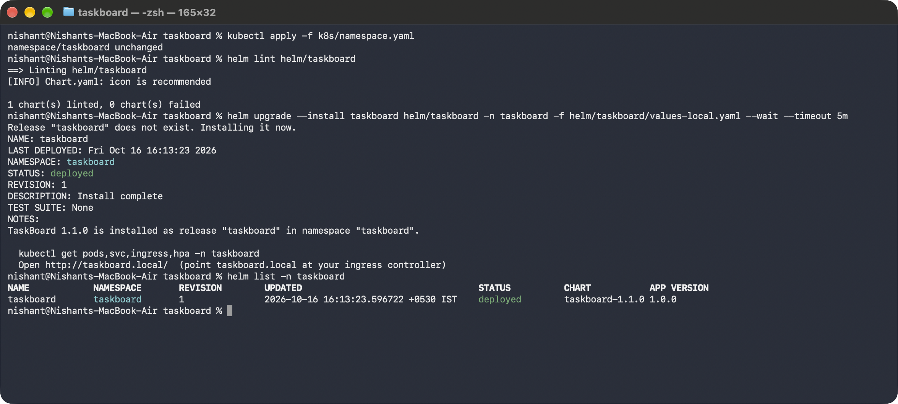

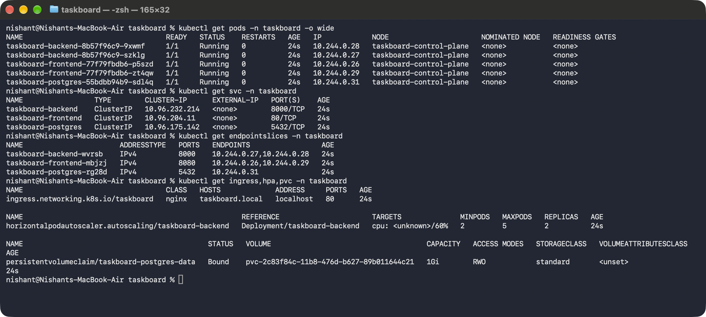

---

## Part K. Ingress

One host, `taskboard.local`, two logical routes: `/api` (plus `/docs` and `/openapi.json`) to the backend Service, everything else to the frontend Service. The Ingress is only configuration; the ingress-nginx controller in the cluster implements it.

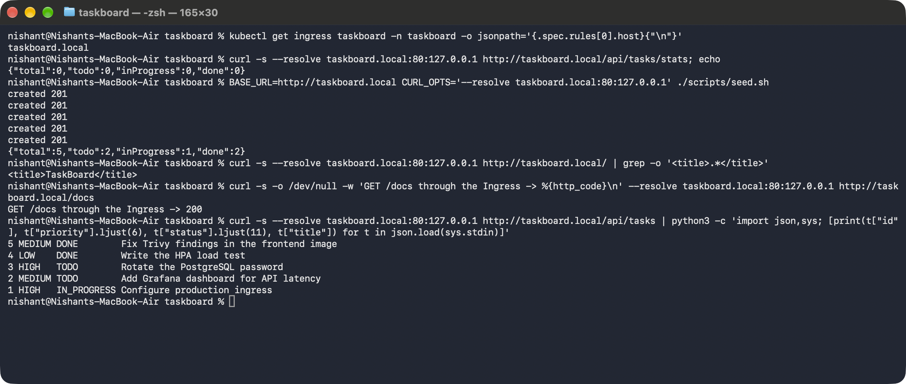

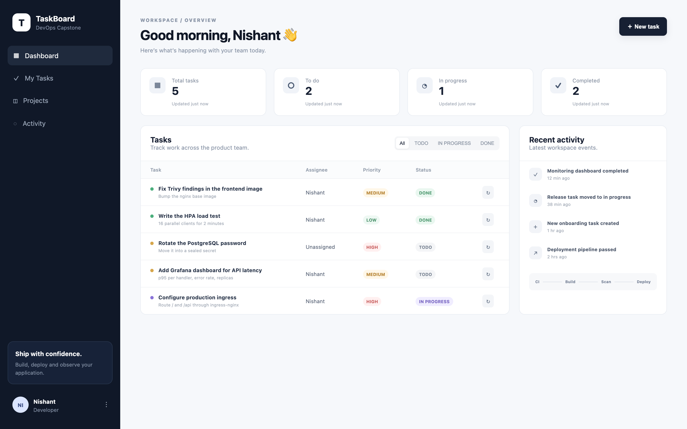


---

## Part L. Horizontal Pod Autoscaler

The HPA targets 60 percent of the backend's CPU request (100m) between 2 and 5 replicas. A normal health check never creates that much CPU, so `scripts/load-test.sh 160 16` ran sixteen parallel clients against `/api/tasks` through the Ingress while `kubectl get hpa` was sampled every twenty seconds.

Sampled every twenty seconds: before the load the backend sat at 3 percent of its CPU request. Forty seconds into the test the HPA measured 408 percent and had already added two Pods (4 running); at the next sample it was at the maximum of 5 replicas with 413 percent, and with the same load spread across five Pods utilisation settled between 98 and 186 percent, with `kubectl top` showing 70 to 200 millicores per Pod. After the test the `scaleDown` stabilisation window (60 s) and the controller's cooldown bring it back to 2, which the final-state screenshot at the end shows.

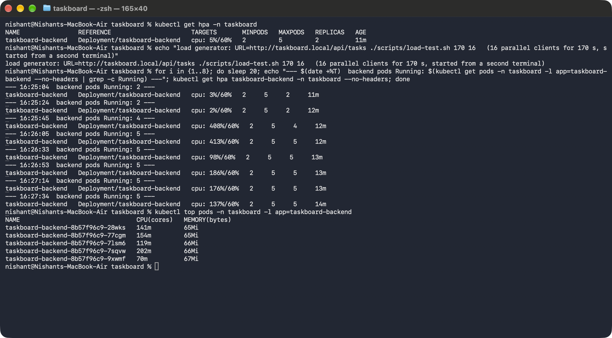

---

## Part M. Monitoring

`monitoring/prometheus-values.yaml` installs `kube-prometheus-stack` (Prometheus Operator, Prometheus, Grafana with the dashboard sidecar, node-exporter, kube-state-metrics; Alertmanager off) and tells Prometheus to pick up every ServiceMonitor in every namespace. The chart's ServiceMonitor then registers the backend Service as a scrape target on `/metrics` every 15 seconds, and `monitoring/grafana-dashboard.yaml` is a ConfigMap the sidecar turns into the dashboard "TaskBoard API (Session 21)": targets up, requests per second, 5xx rate, available replicas, requests by handler, p50/p95/p99 latency, requests by status class, CPU per backend pod.

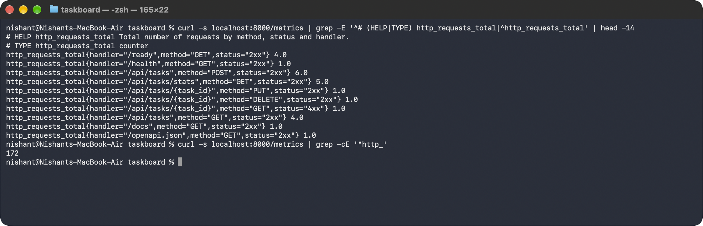

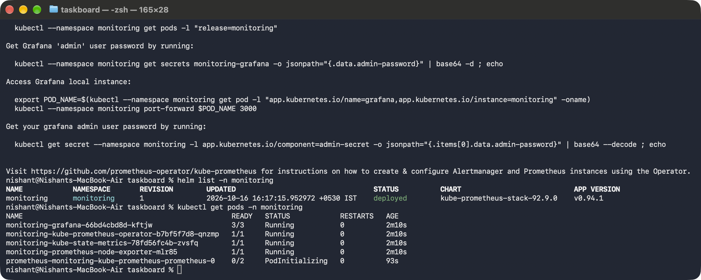

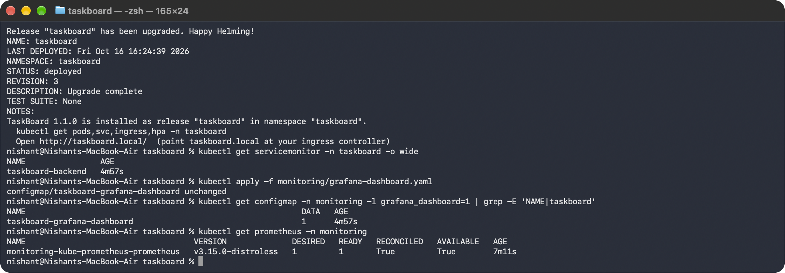

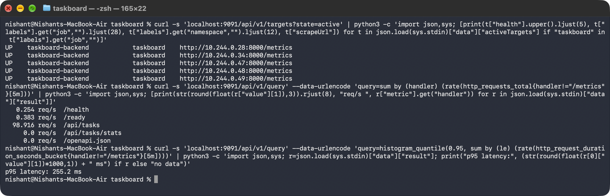

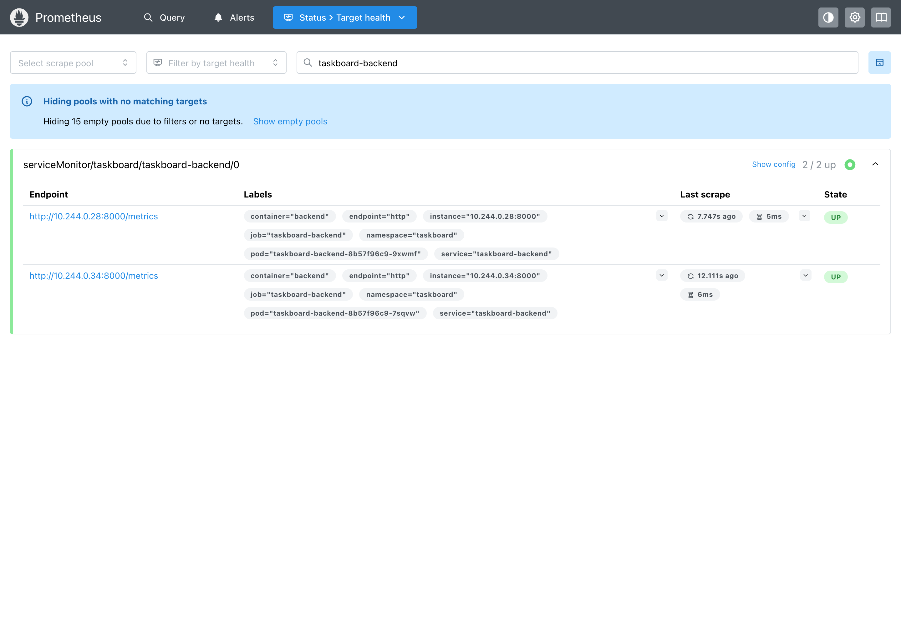

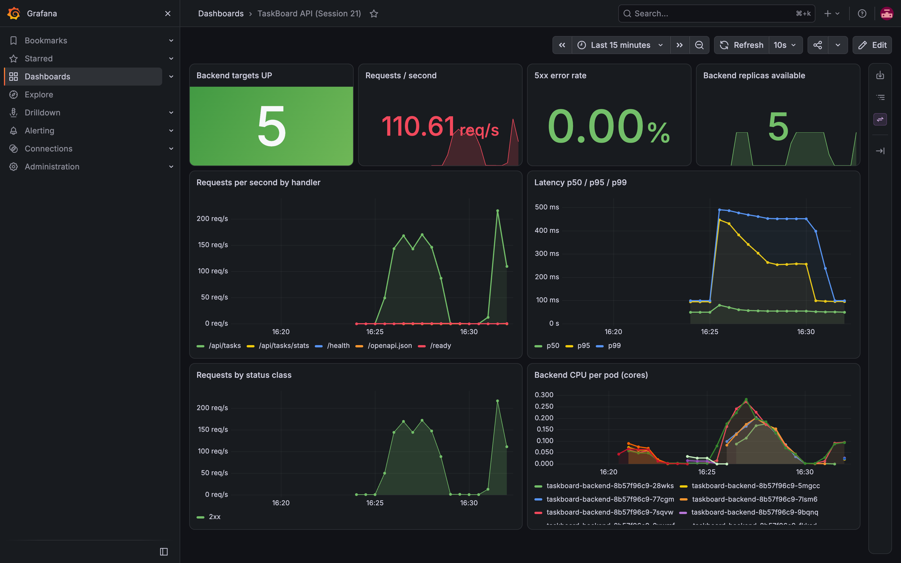

---

## Part N. Troubleshooting lab

The Session 14 ladder: `get`, `describe`, `events`, `logs`, fix, verify.

**Broken image.** `troubleshooting/broken-image.yaml` points a Deployment at a tag that does not exist. The Pod goes `ErrImagePull` then `ImagePullBackOff`; `describe` and the events name the exact image. `kubectl set image` to a real tag (and the database URL from the chart's Secret, since this is the backend image) and the Pod is Running.

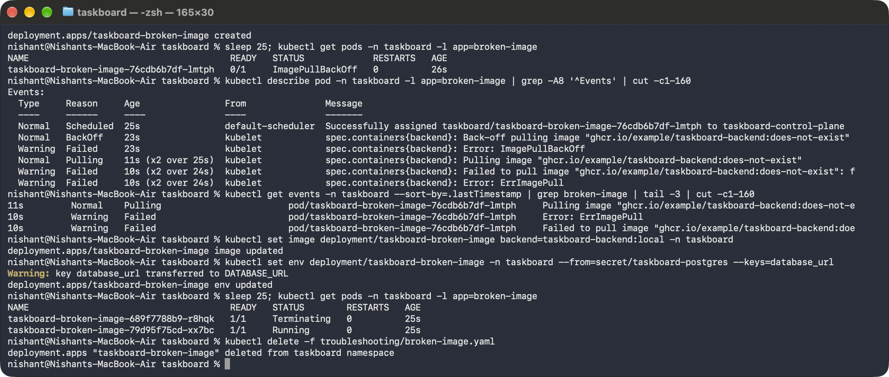

**Broken Service.** `troubleshooting/broken-service.yaml` selects `app: label-that-does-not-exist`. The Service exists but its endpoints are `<none>` while two backend Pods with `app=taskboard-backend` run next to it. Patching the selector fills the endpoints immediately. No matching labels, no endpoints, no traffic.

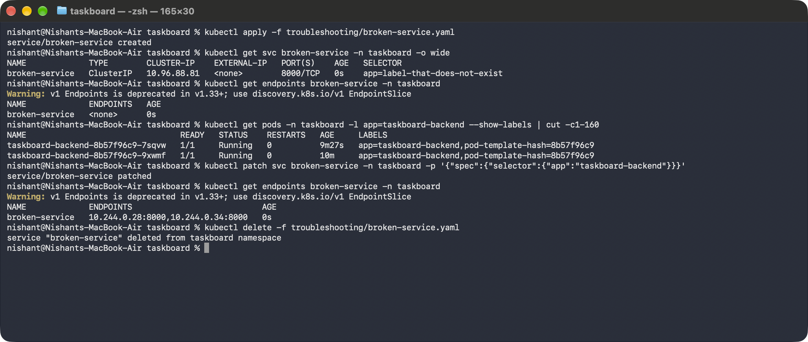

---

## Part O. Demo script

1. Application: open http://taskboard.local (or http://localhost:3000 on Compose), create a task, advance its status.
2. API: `/docs`, create, read, update, delete a task.
3. Database: `kubectl exec -n taskboard deploy/taskboard-postgres -- psql -U taskboard -c 'select * from tasks'`.
4. Git: change the greeting in `frontend/src/main.jsx`, commit with a meaningful message.
5. CI: push, open the Actions run: test, build-scan-push, deploy.
6. Docker: `docker images | grep taskboard`.
7. Security: the Trivy steps in the run (or `trivy image` locally as above).
8. Registry: the two packages on GHCR with the SHA tag.
9. Terraform: `terraform plan` with credentials, the VPC and EKS resources it would create.
10. Kubernetes: `kubectl get pods,svc -n taskboard`.
11. Helm: `helm list -n taskboard`, `helm history taskboard -n taskboard`.
12. Ingress: the hostname in the browser.
13. HPA: `kubectl get hpa -n taskboard -w` while `scripts/load-test.sh` runs.
14. Monitoring: Prometheus targets, the Grafana dashboard moving under load.
15. Failure: apply a broken manifest, find it, fix it.

Final state of the cluster at the end of the lab:

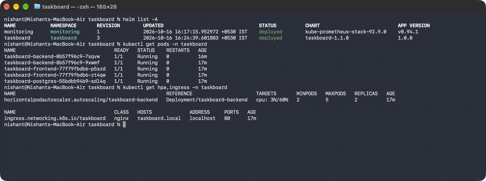

---

## Rubric cross-check

| Module | Done here | Still needs |
| --- | --- | --- |
| M1 application | Backend, 9 endpoints, Alembic migration, React UI, responsive | |
| M2 tests | 13 tests, SQLite conftest, `pytest.ini` | |
| M3 Git | Ignores in place, folder committed and pushed to `main`, root README index | |
| M4 Docker | Both Dockerfiles non-root, multi-stage frontend, Compose with health checks | |
| M5 CI/CD | Workflow at the repository root, SHA tags, GHCR push, Helm deploy; green run and public packages in Part F | |
| M6 Trivy | In the pipeline and run locally; before/after findings explained | |
| M7 Terraform | HCL, `init`, `fmt`, `validate`, `tfvars.example` | AWS credentials for `plan`, `apply`, console screenshot, `destroy` |
| M8 Kubernetes + Helm | Namespace, chart, 2 replicas each, ClusterIP Services, Ingress, all Running | |
| M9 Observability | `/metrics`, Prometheus scraping, Grafana dashboard with live panels | |
| M10 Docs + demo | This README and the demo script | The live demo |

## Cleanup

```bash
cd session-21-python-capstone/taskboard
docker compose down -v
helm uninstall monitoring -n monitoring; helm uninstall taskboard -n taskboard
kind delete cluster --name taskboard
```

Every terminal screenshot in `screenshots/` is a real Terminal.app window captured while the command ran on this Mac; the browser screenshots are headless Chromium at 2x.
